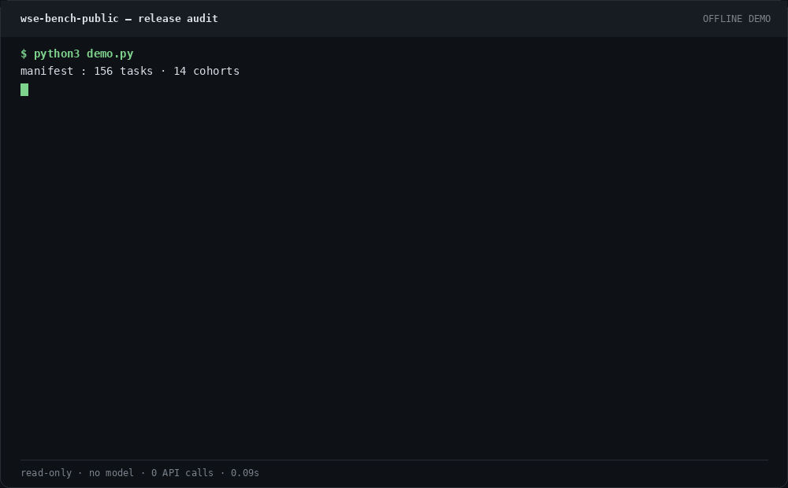

# WSE-Bench — sealed tasks and ledger for eval-gated self-evolution

[](https://github.com/aidless/wse-bench-public/actions/workflows/secret-scan.yml)
[](https://github.com/aidless/wse-bench-public/actions/workflows/release-audit.yml)
[](LICENSE)  [](LICENSE-DATA)

[](LICENSE)
[](https://www.python.org/)

This repository releases 156 sealed tasks and a 37-entry evolution ledger for eval-gated self-evolution on small LLMs.
It is a data and report release, not a supported CLI product and not an installable package.
`python3 demo.py` audits those sealed files offline. It does not run a model, and it is not a live evolution loop.

**STATUS: WORK-IN-PROGRESS — not A yet.** No independent live reproduction is in this tree. Gaps: [`STATUS.md`](STATUS.md). Failure modes: [`FAILURE_MODES.md`](FAILURE_MODES.md).

## Offline audit (fresh clone)

No install and no model. Standard library only:

```bash
git clone https://github.com/aidless/wse-bench-public && cd wse-bench-public
python3 demo.py
python3 tools/check_release_drift.py
```



`demo.py` checks 153 hash-locked tasks, names the 3 documented redactions
(T029–T031), counts the 37 ledger entries, reprints the stored r28 paired-test
summary, and exits 0 only if the drift check passes. The drift check fails
when those counts move, when a hash failure is anything other than T029–T031,
or when the r28 summary disagrees with the ledger outside the rounding
tolerance in [`FAILURE_MODES.md`](FAILURE_MODES.md). Counts come from
[`assets/bench_manifest.json`](assets/bench_manifest.json) (156 tasks; 153 hash-locked + 3 redactions)
and [`assets/evolution_ledger.json`](assets/evolution_ledger.json) (37 entries).

`eval_self_evolution.py --verify` still exits 2 on T029–T031. That is the
redaction refusal. The drift check also fails if `--verify` exits 0: a clean
lock would mean this is no longer the 153 + 3 release. There is **no pytest
suite and no install entry point** — `pytest` finds nothing, by design.

## What CI runs

| Workflow | Proves | Does not prove |
|---|---|---|
| [secret-scan](.github/workflows/secret-scan.yml) | gitleaks on full git history | a statistical claim |
| [security-audit](.github/workflows/security-audit.yml) | sensitive-residue scan, `compileall`, T029–T031 placeholders | a model rerun |
| [release-audit](.github/workflows/release-audit.yml) | `demo.py` and the 156/153/37 drift check | a live evolution loop |

The release-audit badge is that offline gate. It is not a model score.

## What this repo gives you

| Component | Where | Purpose |
|---|---|---|
| Benchmark manifest | `assets/bench_manifest.json` | 156 tasks across 14 cohorts (core / ext / fact / hard / rc{1-4} / reason / struct / sv / verify / 2026Q4-core / 2026Q4-protocol) |
| Deterministic grader | `eval_self_evolution.py` | `score_task`, `is_pass`, `PASS_THRESHOLD` |
| Audit harness | `audit_contamination.py`, `_audit_contamination_r28.py` | Detects prompt-leakage bugs and impossible-closedbook probes |
| Per-round ledger | `assets/evolution_ledger.json` | Append-only audit log of every promotion/revert decision (37 entries, r17 → r28) |
| Reproduction scripts | `_r28_*.py` in the repo root | Author scripts for large-n replication, prefix ablation, multi-model, DPO. Not a package entry point. The leading underscore is part of the filename. |
| Generation protocol | recorded with the r28 notes | Qwen2.5-3B-Instruct 4-bit NF4, T=0.7, top_p=0.9, max_new=128, rep_pen=1.05. `_r27_strict_ablation.py` is not in this tree. |
| Analysis tools | `_r28_effectsize_analysis.py`, `_r28_bootstrap_ci.py`, `_r28_effectsize_summary.json` | Effect-size + 95% CI + power for paired McNemar |
| Research notes | `EFFECT_SIZE_CI_POWER_r28_FINAL.md`, `PATH_A_META_ANALYSIS_r28.md`, `SELF_AUDIT_r25_r26.md`, etc. | Honest negative results, methodology, scope |

## What's *not* in this repo (intentionally)

- **Per-seed model outputs / submissions** — these contain T029-T031 answers that
  leak the original author's private KB scale/path. They are not published.
  Regenerating them needs a local model. That is a live run, not the offline
  audit, and not a package install.
- **Private agent session notes** (`HANDOFF_NEW_CONVERSATION.md`,
  `self-evolution-overview.md`, `peS2o-self-evo-digest.md`,
  `workbuddy-workflows.md`) — kept locally, never published.
- **One-off paper-discovery helpers** (`_batch*_papers.py`) — hard-coded to
  the original author's local KB; not useful outside that environment.
- **Model weights / HF cache** — too large; download via the scripts.

## Live evolution run (not reproduced here)

The commands in this section are the author's generation path. They are not
what CI runs, and they are not a supported install. Absolute paths such as
`F:/hf_cache` and the literal `__WSE_REPO_ROOT__` are **provenance** of the
machine that produced the committed JSON. Leave them as records. Do not read
them as a working layout for a fresh clone.

The headline stored result is **ledger entry #33**: a +18.8% absolute gain on 16
RC-tasks (T103-T118) under a single grounding-prefix intervention, measured
via paired McNemar (b=14, c=29, p=0.0315) on Qwen2.5-3B-Instruct 4-bit NF4.
Those figures are committed artifacts. The offline audit cross-checks them
against `_r28_effectsize_summary.json`. It does not recompute them from new
samples. At n=80 the stored post-hoc power is about 0.59, and ledger entry 35
records a cluster-bootstrap CI lower bound that touches 0. See
[`FAILURE_MODES.md`](FAILURE_MODES.md).
Raw per-task rows are in [`results_r27_strict_grounding_k5.json`](results_r27_strict_grounding_k5.json);
the derived b/c/p and aggregates are in
[`r27_strict_ablation_analysis.json`](r27_strict_ablation_analysis.json).

Author command log (provenance, not a fresh-clone recipe):

```bash
# 1. Install dependencies (a Linux/macOS shell or WSL; tested on Python 3.11)
python -m venv .venv && source .venv/bin/activate
pip install torch==2.5.1 transformers==4.57.3 bitsandbytes peft trl scipy

# 2. Download Qwen2.5-3B-Instruct (≈6 GB)
python _download_qwen3b.py --out F:/hf_cache/models/Qwen--Qwen2.5-3B-Instruct

# 3. Run the strict ablation (paired base vs cand, K=5 seeds, 16 tasks)
# NOTE: _r27_strict_ablation.py was not committed; cand-arm (with grounding prefix) results are preserved in results_r28_prefix_ablation_k5.json
# NOTE: _ablation_30q_k5.py was not committed (only a macOS "._" shadow file); base-arm results are in ablation_comparison_30q.json and results_ablation_30q_k5.json

# 4. Effect size + CI + power
python _r28_effectsize_analysis.py    # writes _r28_effectsize_summary.json
python _r28_bootstrap_ci.py           # cluster bootstrap (B=20000)

# 5. Large-n replication (32 tasks × K=15)
python _r28_largen_replication.py     # writes _r28_largen_summary.json

# 6. Prefix component ablation (4 arms × 16 tasks × K=5)
python _r28_prefix_ablation.py        # writes _r28_prefix_ablation_summary.json
```

**Paths (provenance).** Some root scripts still contain the literal
`__WSE_REPO_ROOT__`. That string is the author's placeholder, not a directory
you should create. The scripts that include it read `WSE_REPO_ROOT` first:

```bash
export WSE_REPO_ROOT="$(pwd)"
python3 tools/fix_repo_root.py
```

The tool prints the live count. It exits 1 only when a file keeps the literal
and does not read the env var. An earlier README claimed every script needed a
hand edit. That was wrong. The generation scripts call `torch.manual_seed(seed)`
per call. The offline audit does not rerun them, so it does not confirm
bit-exact outputs on a new machine.

## Scope and known limits (honest disclosure)

- **Single-model evidence so far**: Qwen2.5-3B-Instruct is the only model for
  which all #33 evidence (r27 strict ablation + r28 large-n) was generated.
  Multi-model replication (Llama-3.1-8B, Mistral-7B) was attempted on a
  6 GB-VRAM / 16 GB-RAM development laptop but could not complete due to
  physical constraints (Llama 8-bit CPU load OOMs at shard 2/4; GPU cannot
  fit 8B 4-bit + KV cache + activation). The corresponding row in
  `EFFECT_SIZE_CI_POWER_r28_FINAL.md` §4 is explicitly marked "未消" (not
  closed), with cloud-grade compute required to close it.
- **Closed-source probes (T029-T031)** are kept in the manifest as
  `REPLACE_WITH_YOUR_*` placeholders that you instantiate on your own
  private KB. The probe ability (verify that a model cannot answer a
  private/local fact from parametric memory alone) is preserved without
  leaking any specific path or scale number from the original author's KB.
- **Power**: paired McNemar achieves ~0.59 at n=80 (the original #33 sample),
  ~0.92 at n=240 (r28 OLD16 replication), and >0.99 at n=480 (r28 FULL
  replication). Bootstrap CI lower bound on Δ crosses zero at n=80 but
  is [+6.3%, +33.8%] at n=240 and [+11.9%, +29.0%] at n=480.

## Methodology in one paragraph

Each round, the agent proposes a candidate system prompt (or LoRA / DPO
delta). We generate K≥5 samples per task for both candidate and baseline on
the same fixed seeds, score deterministically, and compute paired McNemar +
bootstrap-CI on the b/c discordant pair counts. A change is **promoted** to
the ledger only if (a) two-sided McNemar p<0.05 **and** (b) the cluster
bootstrap 95% CI lower bound on Δ is strictly positive. Anything else is
honestly marked HOLD, REVERT, FAILED, or STEADY_STATE_NO_PROMOTE with the
raw numbers in the ledger entry.

## Citation

```bibtex
@misc{wse-bench-2026,
  title  = {WSE-Bench: An Eval-Gated Self-Evolution Benchmark for Small LLMs},
  year   = {2026},
  note   = {Open-source release v1.0.0, see \url{https://github.com/aidless/wse-bench-public}}
}
```

## License

Code is MIT — see `LICENSE`.

> **Dual license.** Code in this repository is MIT (`LICENSE`). Benchmark tasks, datasets, documents, and evaluation results are CC BY 4.0 (`LICENSE-DATA`).